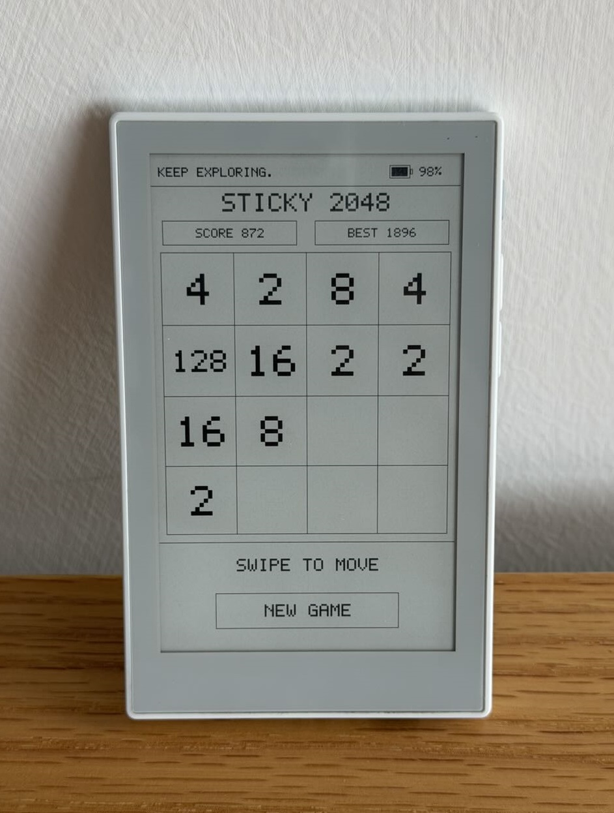

# reTerminal Sticky 2048 E-Ink Game

A community 2048 game demo running on Seeed Studio reTerminal Sticky.

This project demonstrates native ESP-IDF development on reTerminal Sticky,
including E-Ink rendering, touch interaction, partial refresh, and hardware
integration.

The game uses the native 1-bit E-paper framebuffer and ESP-IDF directly,
without LVGL, networking, cloud services, or filesystem dependencies.



## Features

- Native ESP-IDF implementation
- Portrait 480 × 800 UI on the SSD1677 E-Ink display
- 2048 game logic implemented in C++
- GT911 touch swipe control with an independent polling task
- Partial refresh during gameplay with periodic full refresh cleanup
- AI button support:
  - Short press: start a new game
  - Long press: save the current game state and power off
- BQ27220 battery percentage display
- External power detection
- NVS persistence for:
  - Best score
  - Current game state
- Optional LEDC buzzer interface

## Hardware Requirements

- reTerminal Sticky
- ESP32-S3 with PSRAM
- 3.97-inch 800 × 480 E-Ink display

## Development Environment

- ESP-IDF v5.4+
- Python 3.x

## Build and Flash

Set the target, build the firmware, then flash and open the serial monitor:

```bash
idf.py set-target esp32s3
idf.py build
idf.py -p PORT flash monitor
```

Replace `PORT` with the serial port of your reTerminal Sticky.

Project configuration is provided through `sdkconfig.defaults`. The generated
`sdkconfig` file is intentionally excluded from version control.

## Controls

- Swipe up, down, left, or right to move tiles.
- Tap `NEW GAME` to restart the game.
- Short-press the AI button to start a new game.
- Long-press the AI button to save the current game and power off.

## Project Structure

```text
main/
├── game/          # 2048 game logic and NVS save state
├── hardware/      # Display, touch, battery, button, and buzzer adapters
├── ui/            # E-Ink framebuffer rendering and bitmap font
├── main.cpp       # Application entry and refresh management
└── pin_config.h

components/
├── bq27220/       # Battery fuel gauge driver
├── button/        # Button driver
├── debug_logging/ # Logging dependency used by hardware drivers
├── gt911/         # Touch controller driver
└── seeed_epaper/  # E-Ink display driver
```

## Hardware Mapping

| Function | GPIO |
|---|---:|
| AI / Power Button | 4 |
| External Power Detect | 9 |
| E-Paper SPI | 13–18 |
| GT911 I2C | 2, 3 |
| GT911 Enable / Interrupt / Reset | 42, 21, 41 |
| BQ27220 I2C | 0, 1 |
| Charger Enable | 39 |
| Buzzer PWM | 48 |
| Power Hold / Lock | 45, 46 |

## Scope

This project focuses on the core 2048 gameplay experience and E-Ink
interaction on reTerminal Sticky.

To keep the firmware lightweight, this demo does not include Wi-Fi, BLE, OTA,
MQTT, cloud services, LVGL, or unrelated application features.

## License

MIT License
